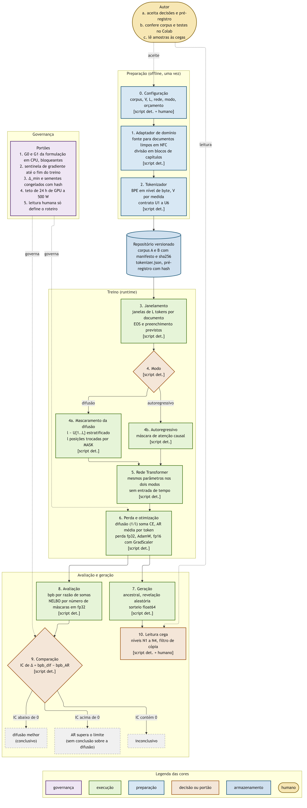
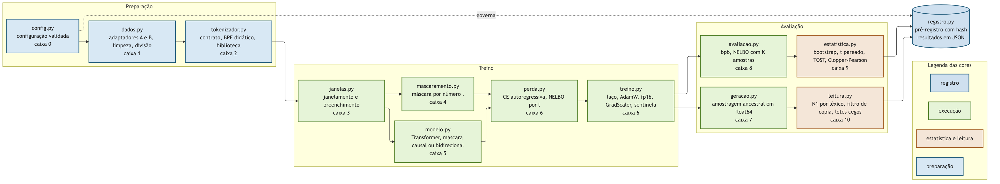

# Arquitetura

Este documento descreve como o projeto se organiza em componentes e como os dados passam entre eles. As fórmulas de cada componente estão em [SPEC.md](SPEC.md), e o formato de cada artefato trocado entre componentes está em [CONTRATO_DADO.md](CONTRATO_DADO.md). As escolhas que a arquitetura implementa foram tomadas nas cinco decisões de `docs/decisao_*.md`.

## 1. Pipeline

O pipeline tem onze caixas numeradas de 0 a 10. Cada caixa é ao mesmo tempo um módulo do pacote `slm/` e uma seção do notebook. Quem lê o notebook percorre as caixas na ordem do diagrama e vê, em cada uma, o que entra, o que acontece e o que sai, antes de passar à seguinte.



Fonte do diagrama em [figuras/pipeline.mmd](../figuras/pipeline.mmd).

A preparação roda uma vez e deixa no repositório tudo o que o treino consome: os dois corpora limpos com manifesto e o tokenizador treinado. O notebook, por isso, não baixa nada além do clone do repositório. A bifurcação na caixa 4 é o único ponto em que os dois modos divergem antes da perda: a difusão troca $l$ posições por `[MASK]` e usa atenção bidirecional, e o autoregressivo mantém o texto e usa atenção causal. A rede da caixa 5 é a mesma nos dois casos.

## 2. Componentes do pacote



Fonte do diagrama em [figuras/componentes.mmd](../figuras/componentes.mmd).

| Caixa | Módulo | Responsabilidade | Seção do notebook | Portões |
|---|---|---|---|---|
| 0 | `slm/config.py` | Configuração validada de corpus, tokenizador, rede, modo e orçamento | Configuração | |
| 1 | `slm/dados.py` | Adaptadores dos corpora A e B, limpeza, segmentação, divisão em blocos e lista de nomes | Adaptador de domínio | Corpus G0 a G3 e G5 |
| 2 | `slm/tokenizador.py` | Contrato do tokenizador, BPE didático e adaptador da biblioteca | Tokenizador | Tokenizador G0 a G5 |
| 3 | `slm/janelas.py` | Janelas de $L$ tokens por documento, com EOS e preenchimento previstos | Janelamento | Formulação G1 e G2 |
| 4 | `slm/mascaramento.py` | Sorteio estratificado de $l$ e mascaramento de exatamente $l$ posições | Mascaramento | Formulação G0 |
| 5 | `slm/modelo.py` | Transformer com máscara de atenção causal ou bidirecional e logit de `[MASK]` em $-\infty$ | Rede | Formulação G0 |
| 6 | `slm/perda.py`, `slm/treino.py` | Perdas dos dois modos, laço de treino, AdamW, fp16 com `GradScaler`, orçamento por passo aplicado e sentinela | Perda e otimização | Precisão G1 a G4 |
| 7 | `slm/geracao.py` | Amostragem ancestral com revelação aleatória e sorteio em float64 | Geração | Formulação G5 |
| 8 | `slm/avaliacao.py` | Bits por byte e NELBO com $K$ amostras | Avaliação | Formulação G3 |
| 9 | `slm/estatistica.py` | Bootstrap por obra e semente, $t$ pareado, TOST, Clopper-Pearson e número de sementes | Comparação | Orçamento G3 a G6 |
| 10 | `slm/leitura.py` | Nível N1 por léxico, filtro de cópia, montagem dos lotes cegos e concordância | Leitura cega | Orçamento G7 |
| | `slm/registro.py` | Pré-registro com hash e gravação de resultados | | Orçamento G0 |

Cada módulo depende só dos que vêm antes dele no diagrama, e nenhum depende do notebook. O notebook importa o pacote e o percorre caixa a caixa, com ilustrações de entrada e saída. Esse arranjo mantém uma única implementação para o treino de pesquisa e para a aula.

## 3. Estrutura do repositório

```
homebrewed-slms/
├── slm/                  pacote, um módulo por caixa
├── tests/                testes de unidade e portões em CPU
├── scripts/              construção do corpus, treino, avaliação, geração do notebook
├── corpus/
│   ├── A/                Machado de Assis limpo, manifesto, divisão, nomes
│   └── B/                legislação federal limpa, manifesto, divisão
├── tokenizador/          tokenizer.json e metadados
├── runs/                 configuração, métricas e resultados de cada corrida
├── preregistro/          pré-registros congelados com hash
├── leitura/              lotes cegos e respostas
├── notebooks/            notebook gerado e o gerador
├── docs/                 problema, pesquisa, decisões, engenharia
├── figuras/              diagramas em .mmd e .png
├── referencias/          fontes de acesso aberto
└── cookbook/             receitas reproduzíveis
```

Os pesos treinados não ficam no git. Os checkpoints usados na aula são publicados junto com o lançamento no Zenodo, e o notebook os baixa a partir do DOI.

## 4. Ambientes de execução

| Ambiente | Papel | Precisão | Restrições |
|---|---|---|---|
| CPU local | Testes de unidade e portões G0 e G1 da formulação, construção do corpus, treino do tokenizador | fp64 e fp32 | |
| RTX 5090 local | Calibração, busca de hiperparâmetros, piloto e comparação confirmatória | fp16 com `GradScaler`, referência em fp32 | Teto de 500 W, uma corrida por vez, teto de 24 h de GPU para a comparação |
| T4 do Colab | Aula, teste de reprodução por TOST | fp16 com `GradScaler` | Sem bf16, sessão sem garantia de GPU nem de duração |

O mesmo código roda nos três ambientes. A diferença entre eles fica na configuração, e o kernel de atenção é fixado igual na 5090 e na T4, conforme a [decisão de precisão](decisao_precisao.md).

## 5. Dependências

O pacote usa PyTorch, `tokenizers` com versão fixada pelo portão G4 do tokenizador, NumPy e SciPy. Os scripts de construção do corpus usam só a biblioteca padrão do Python. As versões exatas ficam num arquivo de requisitos com versões fixadas e são registradas em cada resultado.
